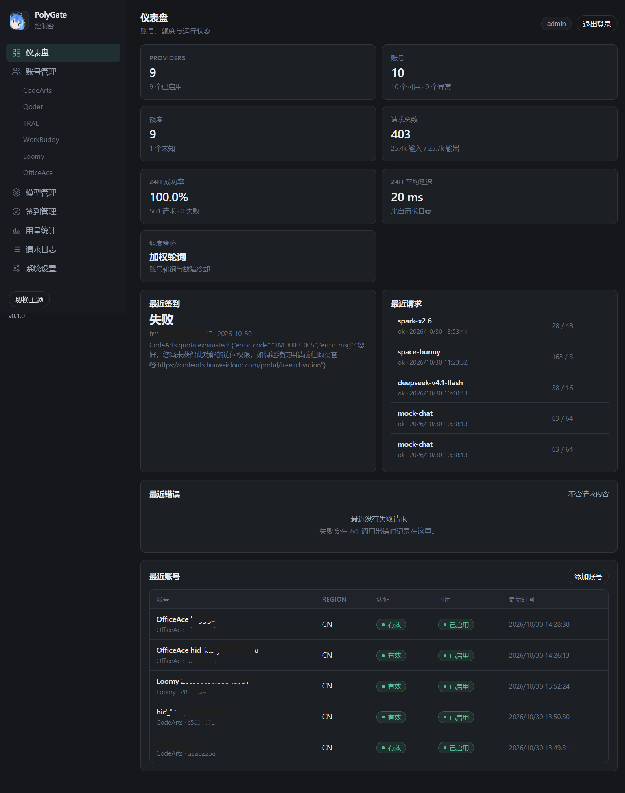
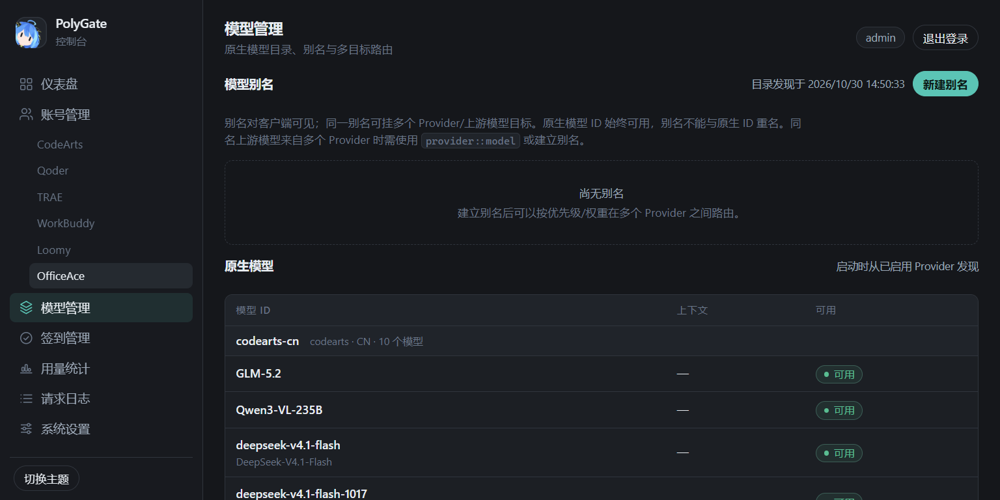
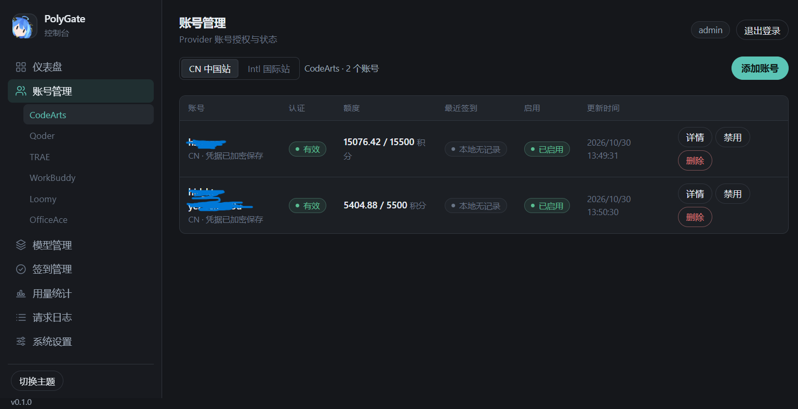
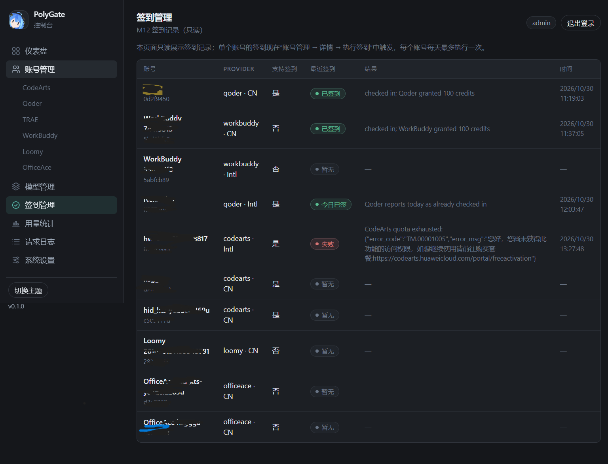
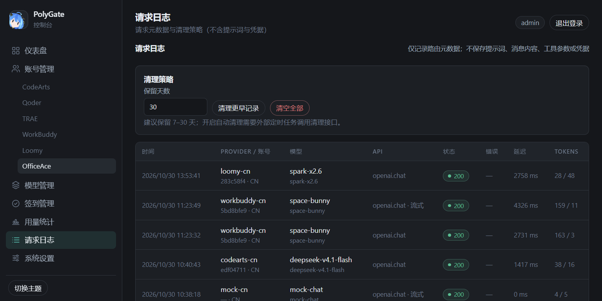
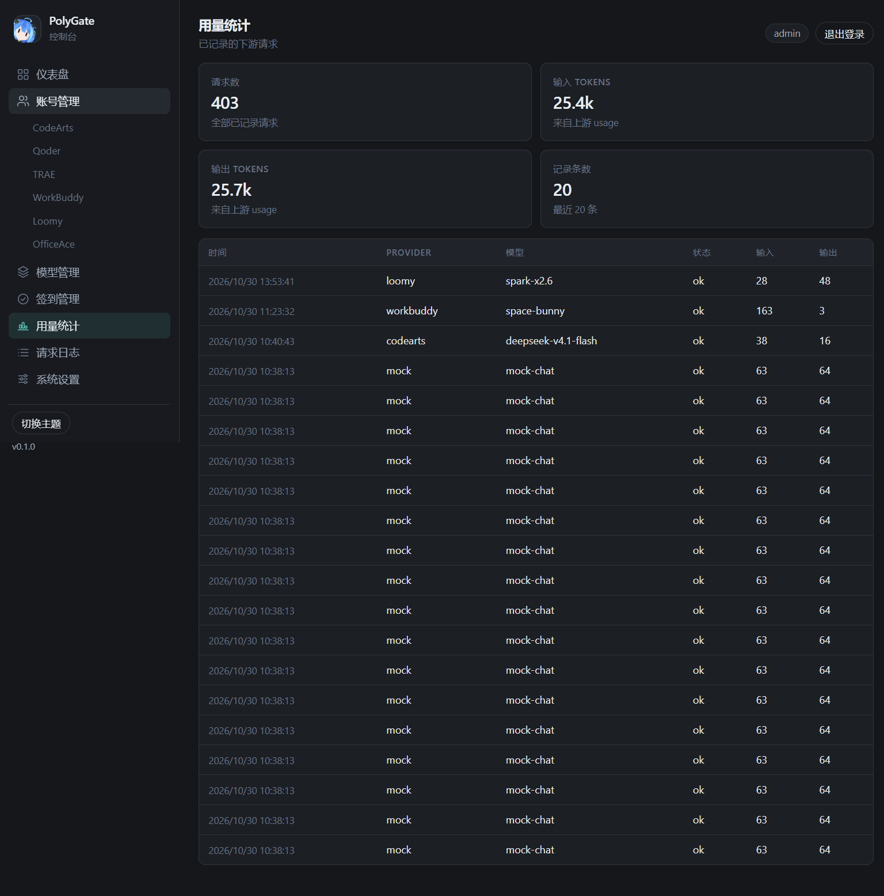
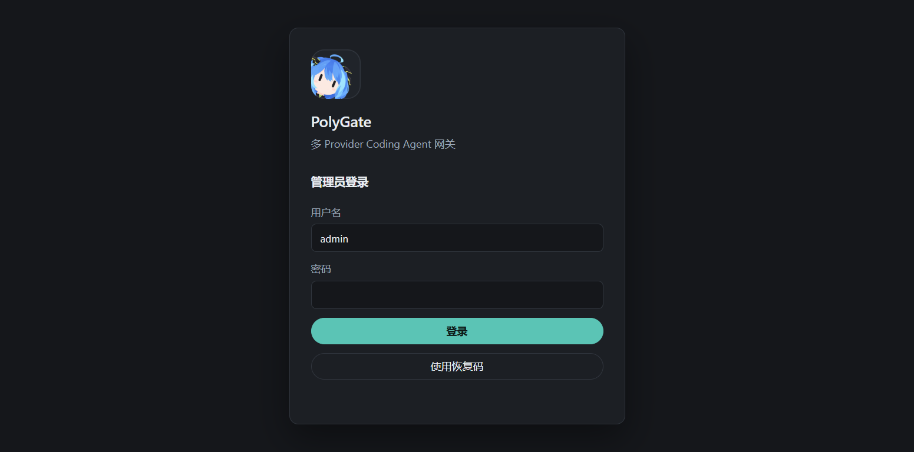

<p align="center"></p>

<h1 align="center">PolyGate</h1>

<p align="center">
  <a href="LICENSE"></a>
  
  
  
  
</p>

<p align="center">
多 Provider 账号池 + Coding Agent API 网关<br>
<sub>一个 10 MB 的 Rust 二进制，把 9 个上游的账号池变成三个标准接口。</sub>
</p>

---

PolyGate 用一套加密保存的本地凭据池，向 Claude Code、Codex、Cursor、Cline、Continue 等客户端
提供 **OpenAI Chat Completions**、**OpenAI Responses** 与 **Anthropic Messages** 三种兼容接口。

它解决的是同一个账号被多个客户端反复挤占的问题：账号按 `(Provider, Region)` 隔离，请求按额度、
健康度和会话粘性分派，额度未知就保持未知，失败只在客户端还没看到输出之前切换。

纯 Rust 单二进制（无 Node、无 Python 运行时），默认只监听 `127.0.0.1`，内置 Web 管理台、
SQLite 持久化、账号调度、模型别名、请求日志与签到管理。凭据只以 AES-256-GCM 加密落盘。

选纯 Rust 是为了**能在低内存设备上长期跑**：软路由、NAS、1 GB 内存的小 VPS。没有 JIT、
没有 V8 堆、没有进程外运行时；在 IPQ6000 软路由上实测常驻 18 MB（见[运行时占用](#运行时占用)）。

## 目录

- [截图](#截图)
- [特性](#特性)
- [支持的 Provider](#支持的-provider)
- [快速开始](#快速开始)
- [客户端接入](#客户端接入)
- [架构](#架构)
- [运行时占用](#运行时占用)
- [部署](#部署)
- [安全默认值](#安全默认值)
- [已知限制](#已知限制)
- [文档](#文档)
- [开发](#开发)
- [致谢](#致谢)
- [许可证](#许可证)

## 截图

部署在软路由上的实际控制台（9 个 Provider、10 个账号，真实上游流量）：

<p align="center"></p>

| | |
| :---: | :---: |
|  |  |
| 模型别名与按 Provider 分组的原生模型 | 账号凭据状态与额度（账号名已打码） |
|  |  |
| 每日签到：成功 / 今日已签 / 失败原因 | 请求日志只存元数据，不含提示词与凭据 |
|  |  |
| 用量统计：请求数、输入/输出 tokens | 管理员登录（Argon2id + HttpOnly 会话） |

## 特性

**协议层**

- `POST /v1/chat/completions` — JSON 与 SSE，tools / tool_choice、`reasoning_content`、`stream_options.include_usage`
- `POST /v1/responses` — 文本、多轮、function call，完整 SSE 事件生命周期（`response.*`）
- `POST /v1/messages` — Anthropic Messages：system / messages / tool_use / tool_result / SSE
- `GET /v1/models`、`GET /health`；错误体按接口分别遵循 OpenAI / Anthropic 形状
- 三种接口共用一份内部 `ChatRequest`，转换层只在上游边界存在

**账号池与调度**

- 多账号、按 `(Provider, Region)` 隔离，CN 与 Intl 账号永不串号
- 三种策略：轮询、平滑加权轮询、最少连接
- 额度感知：只排除**已知**耗尽账号，未知额度保持 `unknown`，不臆测成 0 或无限
- 失败冷却、并发许可、健康度轮换；403/429 单独处理，客户端错误不冷却账号
- 会话粘性（`x-session-id` / 首条用户消息哈希），租约结束自动归还槽位
- 只在可见输出之前故障切换；流式中途失败以 in-stream error 帧结束，绝不静默重放

**模型注册表**

- 别名 → 多目标（provider + upstream model），支持优先级、权重与能力覆盖
- 能力校验（tools / vision / reasoning / context），`provider::model` 消除同名歧义
- 原生模型 ID 始终可用，别名不能遮蔽同名原生模型；控制台按 Provider 分组展示

**运维**

- Web 管理台：授权、账号、额度、签到、模型/别名、用量、请求日志、Provider 状态
- 请求日志只记元数据（Provider、账号内部 ID、模型、状态、延迟、token 数），不存内容
- SQLite 迁移内嵌于二进制，启动自动执行；systemd 加固单元、Dockerfile、OpenWrt procd 脚本
- 深色控制台（细边框、小圆角、青绿强调），跟随系统深浅色，移动端可用

## 支持的 Provider

| Provider | Region | 认证方式 | 状态 |
| --- | --- | --- | --- |
| CodeArts（华为云） | CN | 浏览器 OAuth + STS / DPoP 续期 | **LiveVerified** |
| CodeArts（华为云） | Intl | 同上 | **LiveVerified** |
| Qoder（阿里） | CN | OAuth + COSY 网关 | **LiveVerified** |
| Qoder（阿里） | Intl | 同上 | **LiveVerified** |
| WorkBuddy（腾讯） | CN | 设备码 / 登录态 | **LiveVerified** |
| WorkBuddy（腾讯） | Intl | 同上 | **LiveVerified** |
| Loomy（讯飞） | CN | 导入桌面端会话（14 天） | **LiveVerified** |
| OfficeAce（华为 AgentArts） | CN | 华为云授权（PKCE + DPoP + STS） | **LiveVerified** |
| TRAE（字节） | CN | 登录态 | MockVerified（无真实账号） |
| Mock | — | 无 | 仅测试与本地演示 |

在软路由上的实际部署里，除 TRAE 外的每个 Provider 都有真实账号完成授权：

| 已用真实账号确认的项 | Provider |
| --- | --- |
| 授权 | CodeArts CN/Intl、Qoder CN/Intl、WorkBuddy CN/Intl、Loomy、OfficeAce |
| 模型目录 | CodeArts CN（10）/Intl（2）、Qoder CN/Intl（11/15）、WorkBuddy CN/Intl（15/23）、Loomy（10）、OfficeAce（24） |
| 对话（网关日志 200） | CodeArts CN、WorkBuddy CN（含 SSE）、Loomy |
| 额度 | CodeArts CN、Qoder CN、Loomy、OfficeAce |
| 每日签到 | Qoder CN/Intl（+100 credits）、WorkBuddy CN（+100 credits） |

CodeArts Intl 只暴露 `GLM-5.1`、`GLM-5.2` 两个模型（CN 同账号有 10 个），对话与 SSE 均已实测；
签到被上游额度策略拒绝（`TM.00001005`），额度接口不返回 credit 总量，属于账号权益问题，
不是协议问题。

状态含义：

| 状态 | 含义 |
| --- | --- |
| **LiveVerified** | 该 Provider 已用真实账号完成授权，并至少验证了模型目录、对话、额度、签到中的一项 |
| MockVerified | 协议已实现，只用本地确定性 Mock 服务器验证过，未向真实上游发过请求 |
| Unsupported | 上游不提供该能力，明确不实现 |
| CompatibilityGap | 上游接口存在但行为不兼容，已在文档中记录 |

> **MockVerified ≠ LiveVerified**。逐项能力与未验证项见 [`PROGRESS.md`](PROGRESS.md)：
> TRAE 没有真实账号；Intl 的额度、部分签到与工具调用仍可能返回 unknown/Unsupported。
>
> 明确不支持，也不会加入：CodeBuddy、ZCode、OpenCode Zen。

## 快速开始

```bash
# 1. 构建（工具链固定 Rust 1.98.1，MSRV 1.85）
cargo build --release

# 2. 生成配置
./target/release/polygate config-example > data/config.toml

# 3. 设置密钥：网关 API Key ≥ 16 位；主密钥丢失后已存凭据不可恢复
export POLYGATE_API_KEY="pg-$(openssl rand -hex 16)"
export POLYGATE_MASTER_KEY="$(openssl rand -hex 32)"

# 4. 自检并启动
./target/release/polygate --config data/config.toml --data-dir data doctor
./target/release/polygate --config data/config.toml --data-dir data serve
```

打开 <http://127.0.0.1:8787/> 完成首次初始化：设置管理员密码（Argon2id），拿到一次性恢复码
并离线保存。之后在「账号管理」完成上游授权，在「模型管理」确认模型目录与别名。

第一次调用：

```bash
curl http://127.0.0.1:8787/v1/chat/completions \
  -H "Authorization: Bearer $POLYGATE_API_KEY" \
  -H "Content-Type: application/json" \
  -d '{
    "model": "coding",
    "messages": [{"role": "user", "content": "用一句话解释 Rc<RefCell<T>>"}]
  }'
```

流式与工具调用：

```bash
curl http://127.0.0.1:8787/v1/chat/completions \
  -H "Authorization: Bearer $POLYGATE_API_KEY" \
  -H "Content-Type: application/json" \
  -d '{
    "model": "coding",
    "stream": true,
    "messages": [{"role": "user", "content": "列一下当前目录"}],
    "tools": [{"type": "function", "function": {"name": "ls", "parameters": {"type": "object"}}}]
  }'
```

## 客户端接入

**Claude Code**（Anthropic Messages）：

```bash
export ANTHROPIC_BASE_URL=http://127.0.0.1:8787
export ANTHROPIC_AUTH_TOKEN=$POLYGATE_API_KEY
```

**Codex CLI**（OpenAI Chat Completions），`~/.codex/config.toml`：

```toml
model_provider = "polygate"
model = "coding"

[model_providers.polygate]
name = "PolyGate"
base_url = "http://127.0.0.1:8787/v1"
env_key = "POLYGATE_API_KEY"
wire_api = "chat"
```

**Cursor / Cline / Continue**：OpenAI 兼容模式，Base URL 填 `http://127.0.0.1:8787/v1`，
API Key 填 `POLYGATE_API_KEY`，模型名填别名或 `provider::model`。

模型名可以是别名（可挂多个上游目标），也可以是 `provider::model` 形式的原生模型；
同名模型来自多个 Provider 时必须用后一种写法。

### 选模型：别名与直呼

模型名按「先别名、后原生」解析。原生模型有两种写法：

```
coding                                   # 别名：可挂多个 Provider 目标，带优先级/权重
deepseek-v4.1-flash                      # 原生 ID：只有唯一 Provider 提供时可用
codearts-cn::deepseek-v4.1-flash         # 直呼：provider::model，跳过歧义
workbuddy-cn::glm-5.3
qoder-intl::auto
```

`::` 左边是配置里的 Provider **实例 id**（`codearts-cn`、`workbuddy-intl`、`officeace-cn` …），
不是 kind。不同上游经常代理同一批模型（`deepseek-v4.1-flash` 同时出现在 CodeArts、WorkBuddy、
OfficeAce 的目录里），裸 ID 遇到重名会直接返回 400 并列出候选，不会随机挑一个：

```bash
curl http://127.0.0.1:8787/v1/chat/completions \
  -H "Authorization: Bearer $POLYGATE_API_KEY" \
  -H "Content-Type: application/json" \
  -d '{"model": "codearts-cn::deepseek-v4.1-flash",
       "messages": [{"role": "user", "content": "hi"}]}'
```

想跨 Provider 自动换号，就建别名，把多个 `provider::model` 挂到同一个名字下
（管理台「模型管理 → 新建别名」，或 `POST /admin/api/model-routes`）。

## 架构

```
                   ┌──────────────────────────────────────────┐
  OpenAI / Anthropic│  api/  chat.completions · responses · messages
  兼容客户端 ───────▶│        │  WireRequest → 统一内部 ChatRequest
                   │        ▼
                   │  model_service  别名解析 / 能力校验 / 目标排序
                   │        ▼
                   │  session_service 会话粘性 + 租约；scheduler 选号/冷却/额度
                   │        ▼
                   │  providers/  codearts · qoder · workbuddy · trae
                   │              loomy · officeace · mock
                   └────────┬─────────────────────────────────┘
                            ▼                    storage/  SQLite(WAL) + 迁移
                     上游 Provider 账号池        security/ SecretBox(AES-256-GCM)
```

依赖方向单向：`providers` 不依赖 `scheduler` / `storage`；`api` 不直接接触具体 Provider；
`storage` 不依赖 `api` / `providers`。详见 [`docs/ARCHITECTURE.md`](docs/ARCHITECTURE.md)。

## 运行时占用

**软路由实测**（Kwrt / IPQ6000，4×Cortex-A53，928 MB RAM，aarch64-musl 静态产物）：

| 指标 | 数值 |
| --- | --- |
| 二进制 | 10.8 MiB（11,369,896 B，strip + LTO） |
| 常驻 RSS | 18.2 MB（启动约 21 分钟后采样，9 Provider / 10 账号） |
| 峰值 RSS（VmHWM） | 34.2 MB（含启动期模型目录发现） |
| 线程数 | 8 |
| 虚拟内存 | 36.6 MB |

**Windows 基准**（同机 Mock 上游，16 条 keep-alive 连接、1600 次请求）：

| 指标 | 数值 |
| --- | --- |
| 总耗时 | 0.852 s |
| 吞吐 | ≈ 1878 req/s |
| 平均 / p50 / p95 | 7.27 ms / 4.13 ms / 21.06 ms |
| 常驻内存（空闲 → 满载） | 14.6 MB → 16.7 MB |

内存不随请求量单调增长：请求路径上的分配都是短命的，会持续增长的只有磁盘上的 SQLite 文件；
调度器与会话租约是有界结构。并发流式连接数是唯一的上限来源，每条约几十 KB。
`cargo build` 的 debug 构建会到 60 MB 上下，部署请一律用 `--release`。

## 部署

- 配置：`data/config.toml`（或 `POLYGATE_CONFIG`），完整示例见 [`config.example.toml`](config.example.toml)
- 环境变量：`POLYGATE_API_KEY`、`POLYGATE_MASTER_KEY`、`POLYGATE_LISTEN`、
  `POLYGATE_DATABASE_URL`、`POLYGATE_LOG_LEVEL`、`POLYGATE_TRUST_PROXY`、
  `POLYGATE_SCHEDULER_STRATEGY`
- 密钥不入配置文件；主密钥只来自 `POLYGATE_MASTER_KEY` 或 `data/master.key`（0600，自动生成）

Linux 部署（systemd / Docker / 反代 / 备份 / 升级）见 [`docs/DEPLOYMENT.md`](docs/DEPLOYMENT.md)；
现成单元文件与镜像定义在 [`deploy/`](deploy/)。

**软路由 / ARM 盒子**：提供 `aarch64-unknown-linux-musl` 静态产物，不依赖路由器 libc，
IPQ6000 / MT7986 / IPQ807x 等 Cortex-A53 平台可直接运行。procd 启动脚本与
环境变量模板在 [`deploy/openwrt/`](deploy/openwrt/)，步骤见
[`docs/DEPLOYMENT.md` §12](docs/DEPLOYMENT.md#12-openwrt--kwrtaarch64-软路由)。

跨架构构建：

```bash
cargo install cargo-zigbuild --locked
cargo zigbuild --release --target aarch64-unknown-linux-musl
```

## 安全默认值

- 只监听 `127.0.0.1`；公网部署必须置于 TLS 反向代理之后
- 管理面与数据面凭据分离；管理台用 HttpOnly + SameSite Cookie + CSRF + Origin 校验
- 凭据只经 `SecretBox` 加解密；日志、错误、管理 API 不回显 token / cookie / Authorization
- 请求日志不含提示词、消息内容、工具参数
- 未知额度保持 `unknown`（`null`），不当成 0 或无限
- 不生成设备指纹，不实现验证码破解、批量注册、封禁换号续跑、额度与风控绕过

## 已知限制

- **模型目录在启动时发现**：新增账号或 Provider 后需要重启网关，`/v1/models` 才会出现新模型。
  管理台会提示 `restart_required`。
- **单实例**：调度器状态与 SQLite 写锁都在进程内，不支持多实例共享同一个数据库。
- **图片与多模态输入未验证**：能力矩阵里的 vision 只表示上游声明支持，未做真实请求验证。
- **签到需要显式开启**：`checkin.claim_enabled` 默认关闭；是否允许自动化由操作者对该上游负责。
- **TRAE 尚无真实账号**：协议、刷新、额度与签到只经过 Mock 验证，状态保持 MockVerified。
- **Intl 的部分能力受上游影响**：CodeArts Intl 的签到会被上游额度策略拒绝，Qoder Intl 的额度
  可能仍是 `unknown`，WorkBuddy Intl 的签到为 `Unsupported`。

## 文档

| 文档 | 内容 |
| --- | --- |
| [`docs/API.md`](docs/API.md) | 三种 API 的请求 / 响应 / SSE / 错误格式与示例 |
| [`docs/ROUTING.md`](docs/ROUTING.md) | 模型别名、能力校验、账号调度与故障切换规则 |
| [`docs/DEPLOYMENT.md`](docs/DEPLOYMENT.md) | Linux 构建、systemd、Docker、反代、备份、升级 |
| [`docs/ARCHITECTURE.md`](docs/ARCHITECTURE.md) | 模块职责、依赖方向与技术决策 |
| [`docs/PROVIDERS.md`](docs/PROVIDERS.md) | Provider 能力矩阵与协议差异 |
| [`docs/WEB_ADMIN.md`](docs/WEB_ADMIN.md) | 管理台使用说明 |
| [`docs/LOOMY_MIGRATION.md`](docs/LOOMY_MIGRATION.md) | Loomy 接入：会话导入、协议头、能力与限制 |
| [`docs/OFFICEACE_MIGRATION.md`](docs/OFFICEACE_MIGRATION.md) | OfficeAce 接入：双签名、积分签到、云端授权 |
| [`PROGRESS.md`](PROGRESS.md) | 里程碑、实测结果、未完成项与已知问题 |
| [`AGENTS.md`](AGENTS.md) | 开发规范与安全红线 |

## 开发

```bash
cargo build
cargo test                                        # 746 passed
cargo clippy --all-targets -- -D warnings
cargo fmt --check
```

测试不依赖真实网络与真实凭据，Mock 上游全部确定性。

## 致谢

PolyGate 的协议事实来自这些项目的一手实践。没有它们，每个 Provider 都要从零逆向一遍：

| 项目 | 作者 | 参考内容 |
| --- | --- | --- |
| [RobbsLuo/Coding2API](https://github.com/RobbsLuo/Coding2API) | RobbsLuo | 各 Provider 的协议事实：CodeArts 会话槽位与 `TM.00001041` 并发错误、签到端点与额度字段、WorkBuddy / TRAE / OfficeAce 的请求头族、签名派生与事件格式 |
| [Patrick130306/loomy2api](https://github.com/Patrick130306/loomy2api) | Patrick130306 | 讯飞 Loomy 桌面端协议：14 天会话结构、`traceparent` 头族、模型目录、points 账本与 SSE 事件 |
| [chengzhi-c/dsh-wtq-pool](https://github.com/chengzhi-c/dsh-wtq-pool) | chengzhi-c | 账号池设计：槽位持久化、延迟开放重试、额度分组；Web UI 的视觉语言（深灰分层、青绿强调、细边框、胶囊按钮） |

参考的细节值得单独说一句：Coding2API 把 CodeArts 的槽位并发错误、签到端点与 OfficeAce
的双签名链路讲清楚了；loomy2api 从官方 Electron 客户端 0.9.38 里整理出了 Loomy 的完整
协议文档；dsh-wtq-pool 给出了账号池该有的样子。PolyGate 只吸收协议事实与设计结论，
**没有复制它们的代码**，路由、调度、存储、三种 wire API 与前端均为独立实现。

审计过程与逐条结论见 [`docs/RESEARCH.md`](docs/RESEARCH.md)、[`docs/CHECKIN_RESEARCH.md`](docs/CHECKIN_RESEARCH.md)、
[`docs/CODEARTS_SESSION.md`](docs/CODEARTS_SESSION.md)、[`docs/LOOMY_MIGRATION.md`](docs/LOOMY_MIGRATION.md)。

## 许可证

[MIT](LICENSE)。依赖均为 MIT / Apache-2.0 / BSD / Zlib / ISC 等宽松许可（含多许可选项）。
Coding2API、loomy2api、dsh-wtq-pool 均为 MIT（Copyright 2026 各自作者）；本项目只吸收协议
事实与设计结论，未包含其代码，因此不附带其版权声明。

